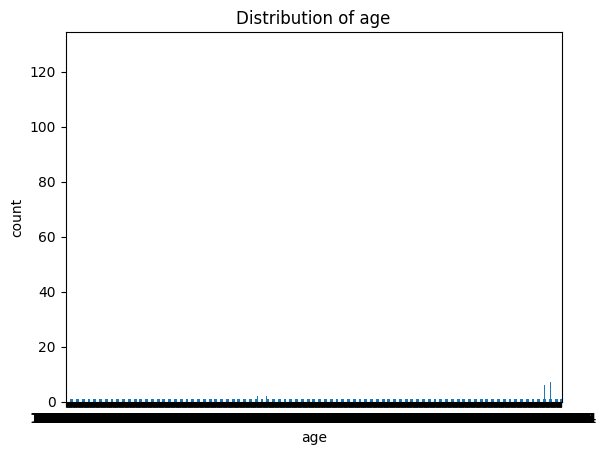
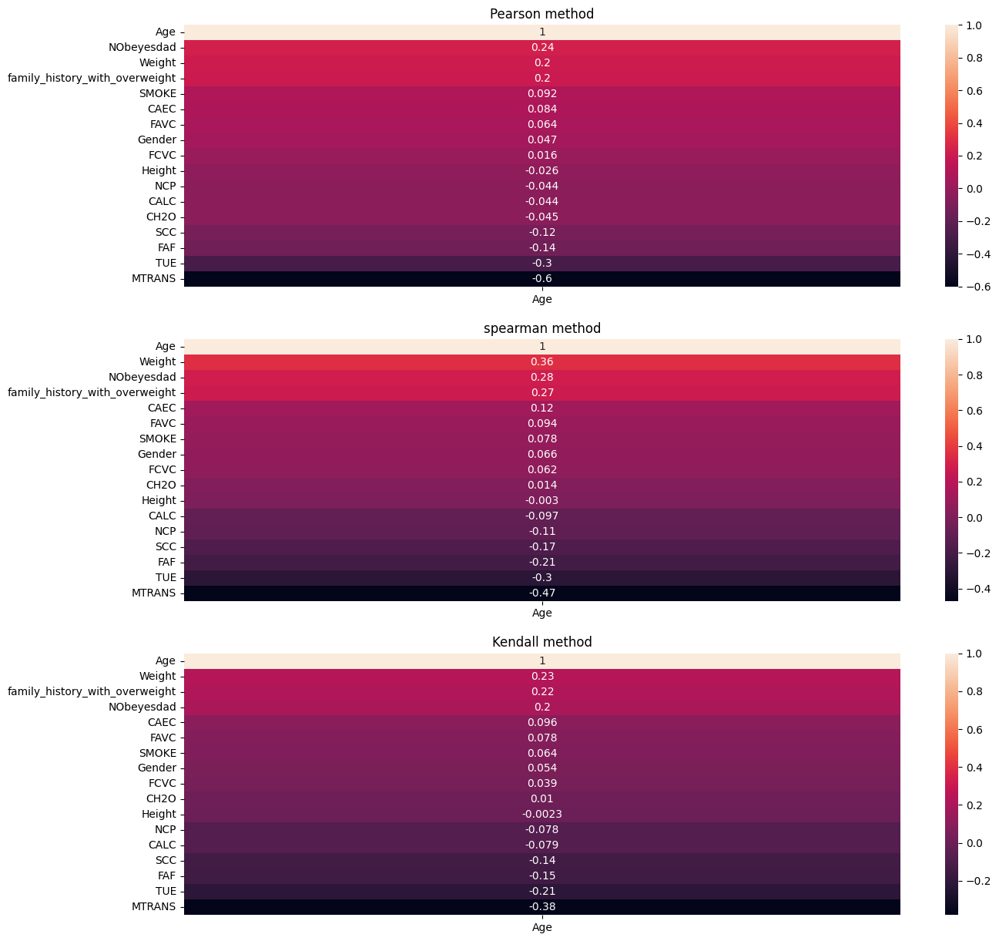
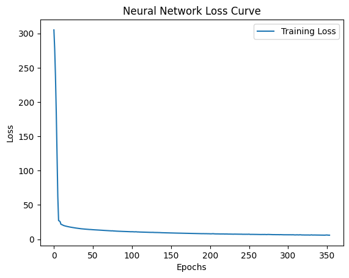
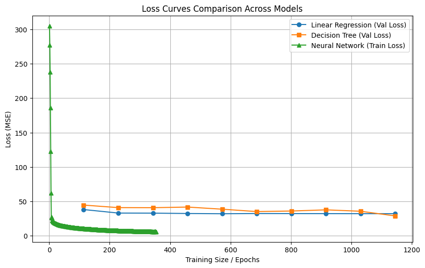

# Lifestyle & Biometric Age Inference: Predictive Age Modeling from Health & Behavioral Patterns

**Inferring age from lifestyle indicators (eating habits, physical activity, BMI, family history) using regression models**

[](https://www.python.org/)
[](https://scikit-learn.org/)
[](https://pandas.pydata.org/)

---

## 📌 Executive Summary

Understanding the relationship between lifestyle behaviors and age is critical for personalized healthcare, targeted wellness interventions, and biometric screening. This project leverages a dataset of **2,111 individuals** containing self-reported eating habits, physical activity levels, biometric measurements (height, weight), and family medical history to build predictive models that estimate customer age.

The system treats **Age** as a continuous target variable and evaluates three regression architectures: Linear Regression, Decision Tree Regressor, and Multi-Layer Perceptron (MLP) with early stopping.

---

## 🏆 Benchmark Results

| Model Architecture | Loss / MSE | RMSE | R² Score | Training Score | Test Score |
|---|---|---|---|---|---|
| **Multi-Layer Perceptron (MLP)** | **29.04** | **5.39 yrs** | **0.27** | **0.33** | **0.27** |
| Linear Regression (OLS Baseline) | 33.55 | 5.79 yrs | 0.15 | 0.16 | 0.15 |
| Decision Tree Regressor (Depth=10) | 38.62 | 6.21 yrs | 0.03 | 0.08 | 0.03 |

**Key Insight:** The MLP significantly outperformed baselines, with R² improvement of **+80%** over linear regression. This suggests that the relationship between lifestyle patterns and age is non-linear and benefits from hidden-layer feature abstraction.

---

## 📊 Visual Diagnostics

| Age Target Distribution | Feature Correlation Matrix |
|---|---|
|  |  |

| Neural Network Training Convergence | Model Learning Curves |
|---|---|
|  |  |

---

## 🛠️ Engineering & Modeling Highlights

1. **Feature Engineering:**
   - Computed **BMI (Body Mass Index)** from Height and Weight for explicit body composition signal
   - Applied **Label Encoding** to binary health flags (SMOKE, FAVC, SCC)
   - Used **One-Hot Encoding** for categorical lifestyle attributes (Gender, CALC, CAEC, MTRANS)
   - Leveraged **StandardScaler** on continuous features (CH2O water intake, FAF physical activity frequency)

2. **Model Architecture Selection:**
   - Baseline (OLS): Establishes linear relationship between predictors and age
   - Decision Tree: Captures non-linear splits in behavioral/lifestyle space with depth regularization
   - MLP Neural Network: 2-layer architecture (128→64) with ReLU activation, Adam optimizer, and early stopping to prevent overfitting on the smaller sample size (2,111 records vs. 41,188 in bank data)

3. **Training Diagnostics:**
   - Monitored epoch-wise loss convergence to ensure gradient stability
   - Generated learning curves to diagnose high variance (overfitting) given limited data

---

## 🗂️ Repository Structure

```text
lifestyle-biometric-age-prediction/
├── notebooks/
│   └── lifestyle_age_inference.ipynb     # Interactive EDA, preprocessing & models
├── src/
│   ├── preprocessor.py                   # Modular feature engineering pipeline
│   ├── models.py                         # Regression & neural network implementations
│   └── __init__.py                       # Package API exports
├── data/
│   └── sample_obesity_lifestyle.csv      # Sample dataset (500 rows) for quick execution
├── assets/                               # Diagnostic plots and correlation heatmaps
├── requirements.txt                      # Pinned dependencies
└── README.md
```

---

## 🚀 Quick Start

### 1. Clone & Install Dependencies

```bash
git clone https://github.com/<your-username>/lifestyle-biometric-age-prediction.git
cd lifestyle-biometric-age-prediction
pip install -r requirements.txt
```

### 2. Run Pipeline Programmatically

```python
import pandas as pd
from src.preprocessor import LifestyleDataPreprocessor
from src.models import train_mlp_neural_network, evaluate_regression_model
from sklearn.model_selection import train_test_split

df = pd.read_csv("data/sample_obesity_lifestyle.csv")
preprocessor = LifestyleDataPreprocessor()
X, y = preprocessor.fit_transform(df, target_col="Age")

X_train, X_test, y_train, y_test = train_test_split(X, y, test_size=0.3, random_state=42)
model = train_mlp_neural_network(X_train, y_train)
metrics = evaluate_regression_model(model, X_test, y_test, model_name="MLP")
print(metrics)
```

### 3. Interactive Notebook

```bash
jupyter notebook notebooks/lifestyle_age_inference.ipynb
```

---

## 👤 Author

**Fayez Ahmad Protik**

Specialized in:
- Healthcare & Biometric Machine Learning
- Feature Engineering for Lifestyle Analytics
- Neural Network Diagnostics on Small-Sample Tabular Data

---

## 📄 License

MIT License — freely available for personal and commercial use.